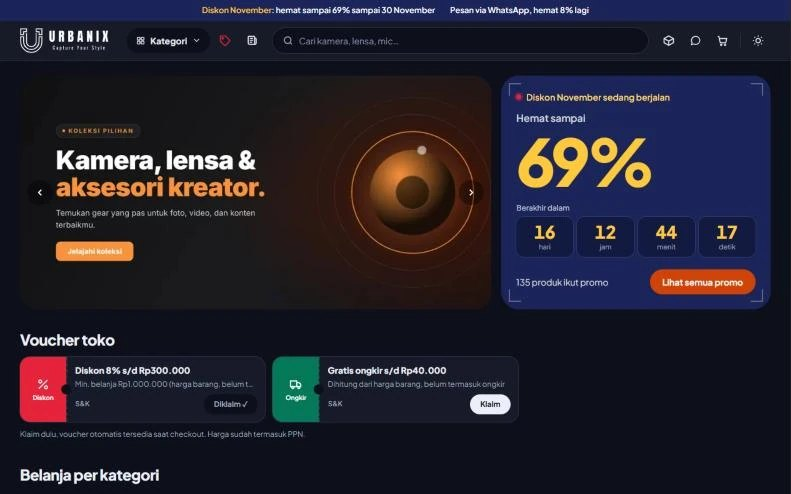
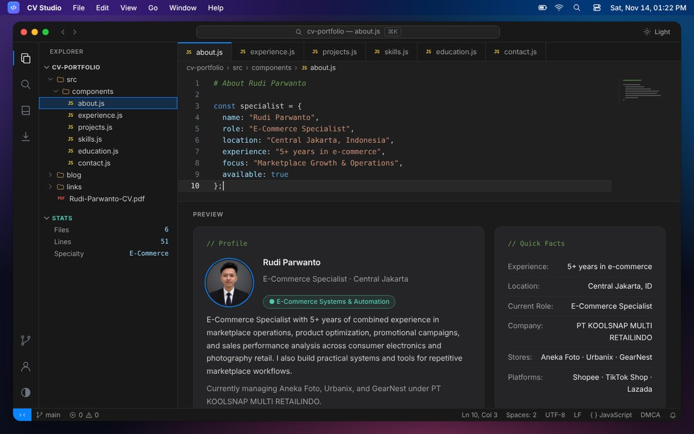

<div align="center">


# Hi, I'm Rudi 👋


<a href="https://masrudi.site"></a>
<a href="https://urbanix.id"></a>
<a href="https://masrudi.site/blog/"></a>
<a href="https://www.linkedin.com/in/rudiparwanto/"></a>
<a href="mailto:jieponk@gmail.com"></a>

</div>

<table>
<tr>
<td width="50%" valign="top">

**`> whoami`**

```js
const rudi = {
  role:    "E-Commerce Specialist",
  company: "PT Koolsnap Multi Retailindo",
  stores:  ["Aneka Foto", "Urbanix", "GearNest"],
  base:    "Jakarta, Indonesia",
  award:   "Shopee Award 2024 — Best Seller",
};
```

</td>
<td width="50%" valign="top">

**`> career.log`**

```diff
+ 2026 → now   E-Commerce Specialist · Koolsnap
+ 2023 → 2026  E-Commerce Specialist · Sinar Agung
! 2024         Shopee Award · Best Seller
  2019 → 2023  Retail & store operations
  2017 → 2019  Marketplace Admin
```

</td>
</tr>
</table>

## `> featured.projects`

<table>
<tr>
<td width="33%" valign="top">

<a href="https://urbanix.id"><picture><source media="(prefers-color-scheme: dark)" srcset="./assets/projects/urbanix-dark.jpg" /><source media="(prefers-color-scheme: light)" srcset="./assets/projects/urbanix-light.jpg" /></picture></a>

**🛒 [urbanix.id](https://urbanix.id)**<br>
<sub>Creator-gear store, built solo. ±211 products, Seller Center, Merchant feed.</sub><br>
<sub>`Next.js` `Django` `PostgreSQL` `Docker`</sub><br>
<sub>[Live](https://urbanix.id) · [Code](https://github.com/jieponk/urbanix-store)</sub>

</td>
<td width="33%" valign="top">

<a href="https://masrudi.site"><picture><source media="(prefers-color-scheme: dark)" srcset="./assets/projects/portfolio-dark.jpg" /><source media="(prefers-color-scheme: light)" srcset="./assets/projects/portfolio-light.jpg" /></picture></a>

**💻 [masrudi.site](https://masrudi.site)**<br>
<sub>Portfolio + blog styled as VS Code on macOS. Dark/light, EN/ID, ⌘K, CMS.</sub><br>
<sub>`JavaScript` `CSS` `Cloudflare Workers`</sub><br>
<sub>[Live](https://masrudi.site) · [Code](https://github.com/jieponk/rudi-parwanto-portfolio)</sub>

</td>
<td width="33%" valign="top">

<a href="https://masrudi.site/#projects"><picture><source media="(prefers-color-scheme: dark)" srcset="./assets/projects/calculator-dark.jpg" /><source media="(prefers-color-scheme: light)" srcset="./assets/projects/calculator-light.jpg" /></picture></a>

**🧮 Pricing Calculator**<br>
<sub>Team tool: net income & margin per marketplace before pricing. Example data shown.</sub><br>
<sub>`JavaScript` `Workers` `REST API`</sub><br>
<sub>🔒 Internal tool</sub>

</td>
</tr>
</table>

## `> stack`

<table>
<tr><td><b>Languages</b></td><td><picture><source media="(prefers-color-scheme: light)" srcset="https://skillicons.dev/icons?i=html,css,js,ts,py,java,kotlin,php,go,cs,powershell,bash&perline=12&theme=light" /></picture></td></tr>
<tr><td><b>Frontend</b></td><td><picture><source media="(prefers-color-scheme: light)" srcset="https://skillicons.dev/icons?i=react,nextjs,redux,tailwind,bootstrap,vite&perline=12&theme=light" /></picture></td></tr>
<tr><td><b>Backend & API</b></td><td><picture><source media="(prefers-color-scheme: light)" srcset="https://skillicons.dev/icons?i=nodejs,express,django,graphql,postman,npm&perline=12&theme=light" /></picture></td></tr>
<tr><td><b>Database</b></td><td><picture><source media="(prefers-color-scheme: light)" srcset="https://skillicons.dev/icons?i=postgres,mysql,mongodb,redis,firebase,supabase&perline=12&theme=light" /></picture></td></tr>
<tr><td><b>Cloud & DevOps</b></td><td><picture><source media="(prefers-color-scheme: light)" srcset="https://skillicons.dev/icons?i=cloudflare,workers,docker,aws,vercel,netlify,git,github,githubactions&perline=12&theme=light" /></picture></td></tr>
<tr><td><b>Workspace</b></td><td><picture><source media="(prefers-color-scheme: light)" srcset="https://skillicons.dev/icons?i=vscode,linux,windows,figma,md&perline=12&theme=light" /></picture></td></tr>
<tr><td><b>Business</b></td><td><code>Shopee</code> <code>TikTok Shop</code> <code>Blibli</code> <code>Product SEO</code> <code>Pricing Systems</code> <code>Automation</code> <code>Internal Tools</code></td></tr>
</table>

<sub>Also: Socket.IO · JWT · Oracle · Render · Excel · Canva · React Router</sub>

## `> github.stats`

<div align="center">


<picture>
  <source media="(prefers-color-scheme: dark)" srcset="https://raw.githubusercontent.com/jieponk/jieponk/output/github-contribution-grid-snake-dark.svg" />
  <source media="(prefers-color-scheme: light)" srcset="https://raw.githubusercontent.com/jieponk/jieponk/output/github-contribution-grid-snake.svg" />
  
</picture>

</div>


<details>
<summary><b>💻 <code>./status</code></b></summary>

```text
jieponk@github:~$ ./status
[✓] building systems
[✓] automating workflows
[✓] shipping projects
[✓] breaking things
[✓] fixing them again
[→] keep building...
```

</details>

<div align="center"><sub><b>code. coffee. ship. repeat.</b></sub></div>
