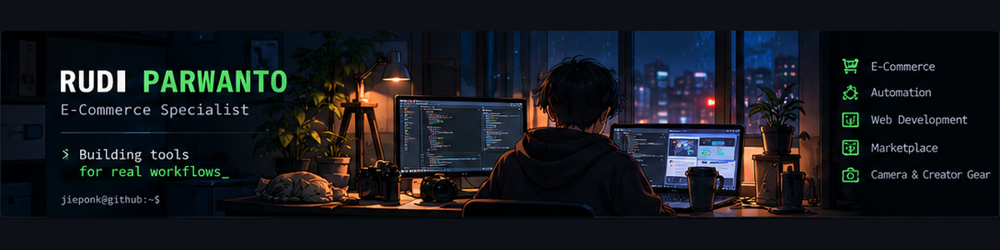
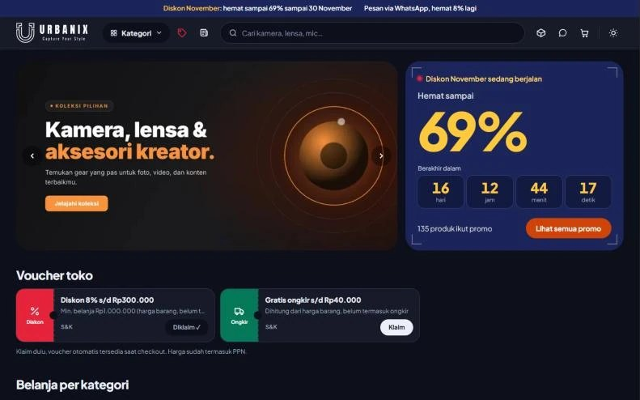
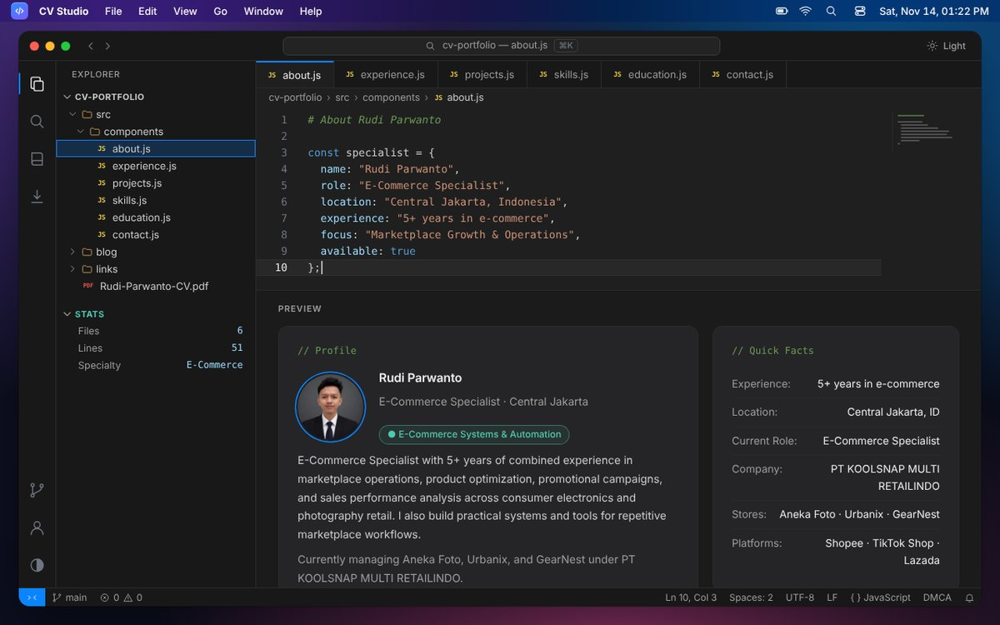
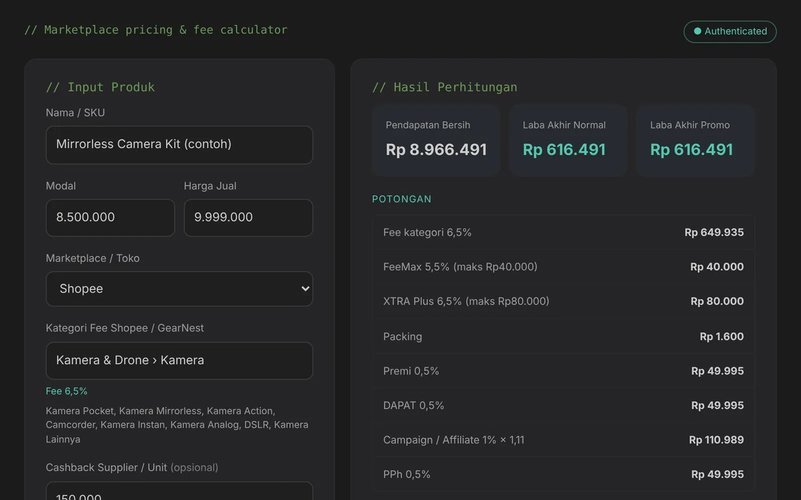

<div align="center">



<br>

# Hi, I'm Rudi 👋


<a href="https://masrudi.site"></a>
<a href="https://urbanix.id"></a>
<a href="https://masrudi.site/blog/"></a>
<a href="https://www.linkedin.com/in/rudiparwanto/"></a>
<a href="mailto:jieponk@gmail.com"></a>

`systems` · `automation` · `marketplace` · `web` · `data`

</div>

---

<table>
<tr>
<td width="50%" valign="top">

### `> whoami`

```js
const rudi = {
  role:     "E-Commerce Specialist",
  company:  "PT Koolsnap Multi Retailindo",
  stores:   ["Aneka Foto", "Urbanix", "GearNest"],
  base:     "Jakarta, Indonesia",
  focus:    "systems for repetitive workflows",
  award:    "Shopee Award 2024 — Best Seller",
};
```

</td>
<td width="50%" valign="top">

### `> currently_building`

```text
📦 marketplace-pricing-center/
⚙️  ecommerce-automation/
🌐 personal-portfolio/   → masrudi.site
✍️  blog-cms/             → /blog
🧪 experiments/
```

</td>
</tr>
</table>

## `> featured.projects`

<table>
<tr>
<td width="50%" valign="top">

<a href="https://urbanix.id"><picture><source media="(prefers-color-scheme: dark)" srcset="./assets/projects/urbanix-dark.jpg" /><source media="(prefers-color-scheme: light)" srcset="./assets/projects/urbanix-light.jpg" /></picture></a>

### 🛒 [urbanix.id](https://urbanix.id)
Online store for creator gear — **built solo from scratch**.
±211 products synced · WhatsApp/Shopee checkout · Seller Center · Google Merchant feed · daily backups.

`Next.js 14` `Django 5.2` `PostgreSQL` `Redis` `Docker` `Cloudflare`

**[Live](https://urbanix.id)** · **[Code](https://github.com/jieponk/urbanix-store)**

</td>
<td width="50%" valign="top">

<a href="https://masrudi.site"><picture><source media="(prefers-color-scheme: dark)" srcset="./assets/projects/portfolio-dark.jpg" /><source media="(prefers-color-scheme: light)" srcset="./assets/projects/portfolio-light.jpg" /></picture></a>

### 💻 [masrudi.site](https://masrudi.site)
Portfolio + blog styled as **VS Code on macOS** — dark/light, EN/ID, ⌘K search, blog CMS.

`JavaScript` `CSS` `Cloudflare Workers` `Sveltia CMS`

**[Live](https://masrudi.site)** · **[Code](https://github.com/jieponk/rudi-parwanto-portfolio)**

</td>
</tr>
<tr>
<td width="50%" valign="top">

<a href="https://masrudi.site/#projects"><picture><source media="(prefers-color-scheme: dark)" srcset="./assets/projects/calculator-dark.jpg" /><source media="(prefers-color-scheme: light)" srcset="./assets/projects/calculator-light.jpg" /></picture></a>

### 🧮 Marketplace Pricing Calculator
Internal tool used by the Aneka Foto team: net income & margin per marketplace (Shopee, GearNest, TikTok Shop, Blibli) before setting a price. *Screenshot uses example data.*

`JavaScript` `Cloudflare Workers` `REST API`

🔒 Internal — no public demo

</td>
<td width="50%" valign="top">

### `> career.log`

```diff
+ 2026 → now   E-Commerce Specialist
+              PT Koolsnap Multi Retailindo
+ 2023 → 2026  E-Commerce Specialist
+              PT Sinar Agung Indotama
! 2024         Shopee Award · Best Seller
  2019 → 2023  Retail & store operations
  2017 → 2019  Marketplace Admin
```

**5+ years** in marketplace operations, product SEO, campaigns and sales analysis.

</td>
</tr>
</table>

## `> stack.wall`

<div align="center">

### Languages


<br><br>

### Frontend / Frameworks


<br><br>

### Backend / Runtime / API


<br><br>

### Database / Backend Services


<br><br>

### Cloud / DevOps / Deployment


<br><br>

### Workspace / Productivity


<br><br>

### Marketplace / Business Systems


</div>

---

## `> github.metrics`

<div align="center">


<br>


</div>

## `> github.trophies`

<div align="center">


</div>

## `> contribution.log`

<div align="center">

<picture>
  <source media="(prefers-color-scheme: dark)" srcset="https://raw.githubusercontent.com/jieponk/jieponk/output/github-contribution-grid-snake-dark.svg" />
  <source media="(prefers-color-scheme: light)" srcset="https://raw.githubusercontent.com/jieponk/jieponk/output/github-contribution-grid-snake.svg" />
  
</picture>

</div>

---

<div align="center">

```text
jieponk@github:~$ ./status

[✓] building systems
[✓] automating workflows
[✓] shipping projects
[✓] breaking things
[✓] fixing them again
[→] keep building...
```

**[masrudi.site](https://masrudi.site)** · **[urbanix.id](https://urbanix.id)** · **[LinkedIn](https://www.linkedin.com/in/rudiparwanto/)** · **[Email](mailto:jieponk@gmail.com)**

</div>
