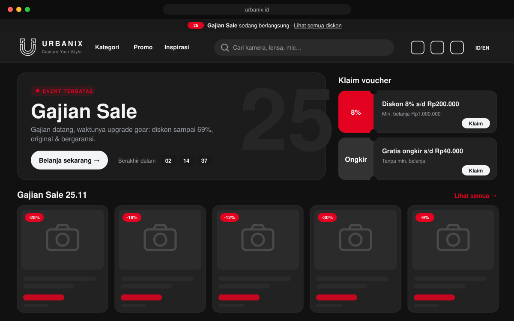
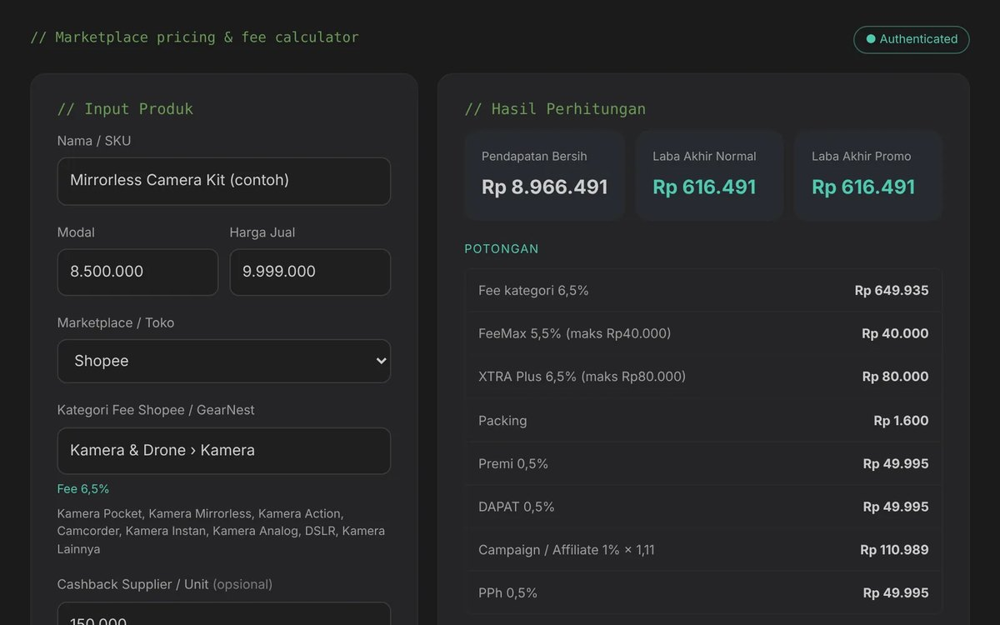

<table>
<tr>
<td width="33%" valign="top">

<a href="https://urbanix.id"><picture><source media="(prefers-color-scheme: dark)" srcset="./assets/projects/urbanix-dark.svg" /><source media="(prefers-color-scheme: light)" srcset="./assets/projects/urbanix-light.svg" /></picture></a>

**🛒 [urbanix.id](https://urbanix.id)** 
Creator-gear store, built solo. 212 products on Google Shopping, Seller Center, web checkout, PageSpeed 99 (mobile). 
`Next.js` `Django` `PostgreSQL` `Docker` 
[Live](https://urbanix.id) · 🔒 Private repo

</td>
<td width="33%" valign="top">

<a href="https://masrudi.site"><picture><source media="(prefers-color-scheme: dark)" srcset="./assets/projects/portfolio-dark.jpg" /><source media="(prefers-color-scheme: light)" srcset="./assets/projects/portfolio-light.jpg" /></picture></a>

**💻 [masrudi.site](https://masrudi.site)** 
Portfolio + blog styled as VS Code on macOS. Dark/light, EN/ID, ⌘K, CMS. 
`JavaScript` `CSS` `Cloudflare Workers` 
[Live](https://masrudi.site) · [Code](https://github.com/jieponk/rudi-parwanto-portfolio)

</td>
<td width="33%" valign="top">

<a href="https://masrudi.site/#projects"><picture><source media="(prefers-color-scheme: dark)" srcset="./assets/projects/calculator-dark.jpg" /><source media="(prefers-color-scheme: light)" srcset="./assets/projects/calculator-light.jpg" /></picture></a>

**🧮 Pricing Calculator** 
Team tool: net income & margin per marketplace before pricing. Example data shown. 
`JavaScript` `Workers` `REST API` 
🔒 Internal tool

</td>
</tr>
</table>

<table width="100%">
<tr><td><b>Languages</b></td><td><picture><source media="(prefers-color-scheme: light)" srcset="https://skillicons.dev/icons?i=html,css,js,ts,py,java,kotlin,php,go,cs,powershell,bash&perline=12&theme=light" /></picture></td></tr>
<tr><td><b>Frontend</b></td><td><picture><source media="(prefers-color-scheme: light)" srcset="https://skillicons.dev/icons?i=react,nextjs,redux,tailwind,bootstrap,vite&perline=12&theme=light" /></picture></td></tr>
<tr><td><b>Backend & API</b></td><td><picture><source media="(prefers-color-scheme: light)" srcset="https://skillicons.dev/icons?i=nodejs,express,django,graphql,postman,npm&perline=12&theme=light" /></picture></td></tr>
<tr><td><b>Database</b></td><td><picture><source media="(prefers-color-scheme: light)" srcset="https://skillicons.dev/icons?i=postgres,mysql,mongodb,redis,firebase,supabase&perline=12&theme=light" /></picture></td></tr>
<tr><td><b>Cloud & DevOps</b></td><td><picture><source media="(prefers-color-scheme: light)" srcset="https://skillicons.dev/icons?i=cloudflare,workers,docker,aws,vercel,netlify,git,github,githubactions&perline=12&theme=light" /></picture></td></tr>
<tr><td><b>Workspace</b></td><td><picture><source media="(prefers-color-scheme: light)" srcset="https://skillicons.dev/icons?i=vscode,linux,windows,figma,md&perline=12&theme=light" /></picture></td></tr>
<tr><td><b>Business</b></td><td><code>Shopee</code> <code>TikTok Shop</code> <code>Blibli</code> <code>Product SEO</code> <code>Pricing Systems</code> <code>Automation</code> <code>Internal Tools</code></td></tr>
</table>

Also: Socket.IO · JWT · Oracle · Render · Excel · Canva · React Router

<picture>
  <source media="(prefers-color-scheme: dark)" srcset="https://raw.githubusercontent.com/jieponk/jieponk/output/github-contribution-grid-snake-dark.svg" />
  <source media="(prefers-color-scheme: light)" srcset="https://raw.githubusercontent.com/jieponk/jieponk/output/github-contribution-grid-snake.svg" />
  
</picture>

